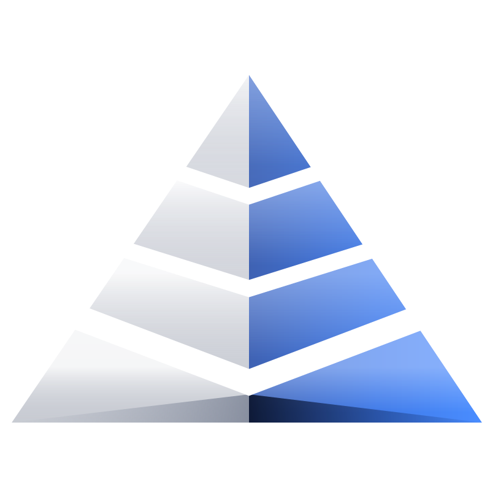

<p align="center"></p>

<h1 align="center">COWL</h1>
<p align="center">Private receive links on Robinhood Chain.<br>ERC-5564 stealth addresses · ERC-6538 registry · live at <a href="https://cowl.pro">cowl.pro</a></p>

---

COWL gives you one public link. Every payment sent to it lands at a fresh one-time address that only you can find and spend from. Anyone looking at the chain sees money going to a new address. They don't see that it's yours.

This repository is the full source of what runs at cowl.pro: the router contract, the cryptography, the web app, and the indexer.

## How it works

1. **Unlock keys.** You sign one fixed message (free, moves nothing). Two private keys are derived from that signature in your browser: a *spending* key and a *viewing* key. Their public halves form your stealth meta-address (`st:eth:0x…`).
2. **Share a link.** Optionally register the meta-address in the canonical ERC-6538 Registry so payers can find it from your wallet address.
3. **Payer sends.** The payer's browser picks a random ephemeral key, computes a one-time address from your public keys, and calls `CowlRouter`. In one transaction, the router forwards the funds to that address and emits an ERC-5564 `Announcement`.
4. **You scan.** Your browser reads announcements and tests each one with the viewing key. A 1-byte view tag discards about 255 of every 256 foreign payments with a single curve multiplication.
5. **You withdraw.** For each match, the browser derives the one-time private key (`spend + h mod n`) and moves the funds wherever you choose.

Keys never leave the browser. The server only relays public `Announcement` logs.

## Contracts (Robinhood Chain, chain id 4663)

| Contract | Address | Notes |
|---|---|---|
| ERC-5564 Announcer | [`0x55649E01B5Df198D18D95b5cc5051630cfD45564`](https://robinhoodchain.blockscout.com/address/0x55649E01B5Df198D18D95b5cc5051630cfD45564) | Canonical standard contract (CREATE2 address). Not ours. |
| ERC-6538 Registry | [`0x6538E6bf4B0eBd30A8Ea093027Ac2422ce5d6538`](https://robinhoodchain.blockscout.com/address/0x6538E6bf4B0eBd30A8Ea093027Ac2422ce5d6538) | Canonical standard contract. Not ours. |
| **CowlRouter** | [`0x5A254fE1f65e5cbBe978095ab4632E7446Bd8590`](https://robinhoodchain.blockscout.com/address/0x5A254fE1f65e5cbBe978095ab4632E7446Bd8590?tab=contract) | [`contracts/src/CowlRouter.sol`](contracts/src/CowlRouter.sol). Verified on Blockscout. |
| **CowlBatch** | [`0xF9283367d8c3CCeCde46EfcA2f63385343269E9F`](https://robinhoodchain.blockscout.com/address/0xF9283367d8c3CCeCde46EfcA2f63385343269E9F) | Private payroll: up to 100 payments in one transaction. [`contracts/src/CowlBatch.sol`](contracts/src/CowlBatch.sol). No owner, no fee, holds nothing. Verified on [Sourcify](https://repo.sourcify.dev/4663/0xF9283367d8c3CCeCde46EfcA2f63385343269E9F). |
| $COWL token | [`0xdCfa97774BA2cb8a9deD0612524984f6f46d4556`](https://robinhoodchain.blockscout.com/token/0xdCfa97774BA2cb8a9deD0612524984f6f46d4556) | Launched on Pons V2. |

**CowlRouter properties:**
- No owner, no admin functions, no upgrade path, no fee.
- It never holds a balance. ETH and tokens go straight to the one-time address.
- About 80 lines, with two external functions:
  - `sendEth(stealth, ephemeralPubKey, viewTag)`
  - `sendToken(token, amount, stealth, ephemeralPubKey, viewTag)`, where any `msg.value` is forwarded as a small ETH gas tip so the receiver can move the token later.

## Verify it yourself

You don't need to trust the website. Each of these checks takes a few minutes.

**1. The deployed router is this code, byte for byte.**

```bash
cd contracts
forge install foundry-rs/forge-std --no-git
forge build
jq -r .deployedBytecode.object out/CowlRouter.sol/CowlRouter.json | tr A-F a-f > local.txt
cast code 0x5A254fE1f65e5cbBe978095ab4632E7446Bd8590 --rpc-url https://robinhood-rpc.publicnode.com | tr A-F a-f > chain.txt
diff local.txt chain.txt && echo IDENTICAL
```

Expected keccak256 of the runtime code: `0xb52f6af50e9580100511ed88672e3056ccc85cd472e114088a5de74512ef692b` (solc 0.8.26, cancun, optimizer 1,000,000 runs, `bytecode_hash = "none"`).

**2. It was tested with real funds before launch.**

| Step | Transaction |
|---|---|
| Router deployed, 18 Oct 2026 20:44 UTC | [`0x66dc0a7f…daaa1`](https://robinhoodchain.blockscout.com/tx/0x66dc0a7f80553177254131e43bc1cabc8dc2be689b3afa7e96ba337c908daaa1) |
| First private payment (0.0002 ETH to a one-time address) | [`0x2540cd66…620bb`](https://robinhoodchain.blockscout.com/tx/0x2540cd6630b5713588ae70f84de7196e61fe516b29d0dadabf0c6f1d379620bb) |
| First withdrawal (found with the viewing key, moved with the one-time key) | [`0x4e28cf14…1ebc9ed`](https://robinhoodchain.blockscout.com/tx/0x4e28cf14f2a09e6162eaba0edb6e510c041146cc25388a451c9431ea61ebc9ed) |

**3. The router holds nothing.** Its balance is shown on the Blockscout page linked above and on cowl.pro.

## Repository layout

```
contracts/          Foundry project
  src/CowlRouter.sol      the router (exact verified source)
  src/CowlBatch.sol       private payroll (many payments, one transaction)
  test/CowlRouter.t.sol   fork tests against the live Announcer and real NVDA stock tokens
  test/CowlBatch.t.sol    fork tests for payroll in ETH and stock tokens
app/
  src/stealth.js          ERC-5564 scheme 1 cryptography (@noble/curves, @noble/hashes)
  src/chain.js            RPC, wallet discovery (EIP-6963), contract ABIs
  src/app.js              Receive / Send / Inbox / Withdraw
  src/landing.js, vault3d.js   landing page and the three.js vault
  src/token.js            $COWL section: market cap chart from on-chain curve trades
  pages/                  HTML (built into app/public)
  public/                 CSS, config.json, static assets
server/server.mjs   static server + announcement indexer (/api/announcements, /api/stats)
                    + COWL Names: cowl.pro/name → receive keys (/api/names, claim needs $COWL)
                    + $COWL trades read from the Pons bonding curve (/api/token)
test/
  stealth.test.mjs        offline unit tests for the cryptography
  e2e.mjs                 full flow on a local fork: register → send ETH + NVDA → scan → withdraw
tools/build.mjs     esbuild bundle
```

Code comments are written in Indonesian. Identifiers, UI text and this README are in English.

## Run it

Requires Node 20+ and, for the contracts, [Foundry](https://getfoundry.sh).

```bash
npm install
npm test                 # offline crypto tests
npm run build            # bundle app + landing into app/public
npm start                # http://127.0.0.1:4791
```

Contract tests fork Robinhood Chain mainnet:

```bash
cd contracts
forge install foundry-rs/forge-std --no-git
forge test -j 1 -vv
```

End-to-end test on a local fork:

```bash
anvil --fork-url https://robinhood.api.pocket.network --chain-id 4663 --port 8645 &
(cd contracts && forge build)
npm run test:e2e
```

## What it hides, and what it doesn't

| | |
|---|---|
| Receiver's main wallet | **Hidden.** Each payment goes to a new one-time address. |
| Link between two payments | **Hidden.** |
| Receiver's private keys | **Never shared.** Derived and used only in the browser. |
| Amount and asset | Public. COWL does not encrypt amounts. |
| Sender's wallet | Public. The payer signs a normal transaction. |
| Withdrawal destination | Public. Withdrawing to your main wallet links that payment to it. |

**Limits, stated plainly:**
- There is no independent audit yet. The router is short and verified, and the cryptography follows ERC-5564 scheme 1 using the audited `@noble` libraries.
- Robinhood stock tokens are issued with controls: the issuer can pause transfers or block addresses, and COWL cannot override that.
- Timing and amount patterns can still hint at who received a payment.

The message you sign is fixed in [`app/src/stealth.js`](app/src/stealth.js). Any site that gets you to sign that exact text can derive your COWL keys, so sign it only on cowl.pro.

## Links

- Site and app: https://cowl.pro
- Transparency page: https://cowl.pro/transparency
- X: https://x.com/cowlhq
- Telegram: https://t.me/cowlhq

## License

MIT. The HDRI `app/public/assets/studio.hdr` is "Studio Small 09" from [Poly Haven](https://polyhaven.com) (CC0).
